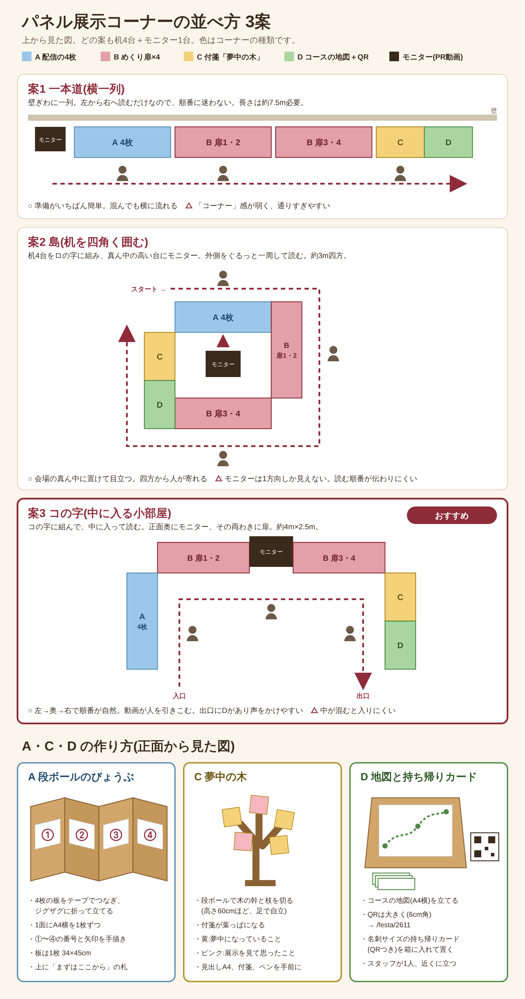
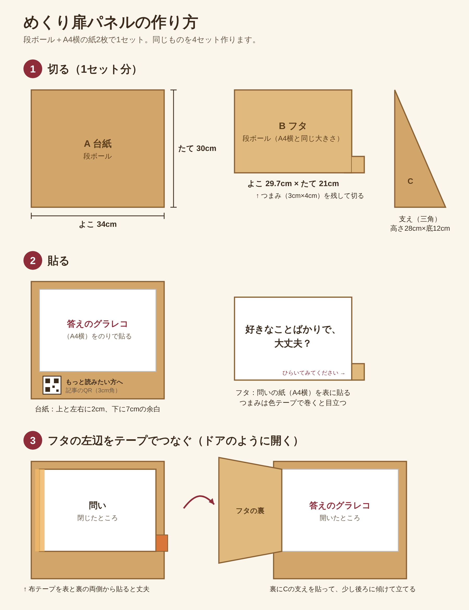
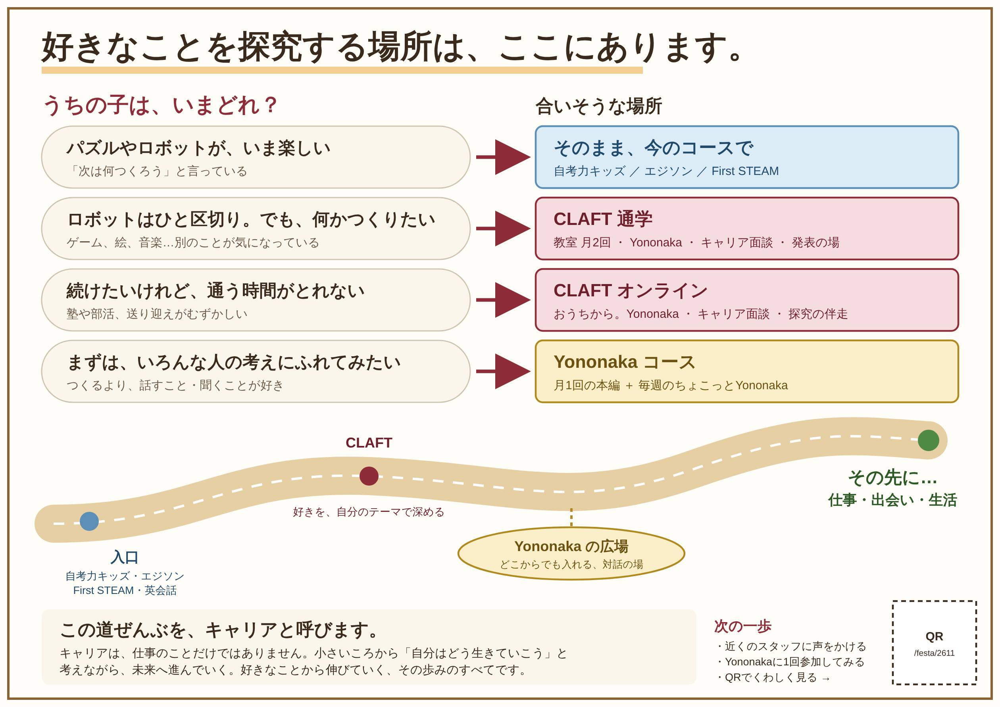

# スクールフェスタ 2026.11.29 パネル展示「好きなことを探究する、その先に…」

2026/11/16 確定分。保護者向け。子ども向けは、作品横のメンバーストーリー(A4)が担う。
Web版は `/festa/2611` の「パネル展示」セクション。

## 方針

- 語り手は「CLAFT」。代表個人(将一郎)の名前・一人称・個人の体験談は出さない。
- ブログは考え方の出どころとして参考にするが、文章は書き下ろす。ブログの文をそのまま載せない。
- 表記は「探究」に統一。「特性」は使わず「その子らしさ」。
- 紙はすべてA4横。段ボールに貼る。

## 会場の並び

| 順 | もの | 枚数 | 中身 |
|---|---|---|---|
| A | スクール配信の4枚(起承転結) | A4横 4枚 | そのまま並べて展示。1枚目がタイトルの役 |
| B | めくり扉 | フタ4枚＋中4枚 | フタ＝保護者の心の声。めくるとグラレコ1枚 |
| C | 付箋コーナー | 見出し1枚 | 来場者が書いて貼る |
| D | コースの地図＋QR | 1枚 | `/festa/2611` へ |

### 並べ方の3案(2026/11/17 提案・未決定)



- 案1 一本道(横一列):準備が簡単。通りすぎやすい。
- 案2 島(机を四角く囲む):会場の真ん中で目立つ。モニターは1方向しか見えず、順番が伝わりにくい。
- 案3 コの字(おすすめ):左→奥→右で順番が自然。正面奥のモニターが人を引きこむ。出口にDがあり声をかけやすい。

各コーナーの作り:A=段ボールのびょうぶ(4面にA4横を1枚ずつ)、C=付箋を葉っぱにする「夢中の木」、D=コースの地図＋大きなQR＋持ち帰りカード。

### A. スクール配信の4枚

1. キービジュアル「好きなことを探究する、その先に…」
2. ゲームが好きな子／野球のピッチングが好きな子(好きは学びの入口)
3. 好きは入口のひとつ(出会いや経験で広がる)
4. スクール生8人の、いま取り組んでいること

※3枚目は制作メモを消した版に差し替え済み。

### B. めくり扉(4つ)

作り方は下の「めくり扉の作り方」を参照。フタは左辺をテープでつなぎ、ドアのように右から開く。
フタは大きな文字で問いを1文だけ。右下に小さく「ひらいてみてください →」。
関連記事のQRは、台紙の下の余白に小さく貼る。

| 扉 | フタ(心の声) | 中のグラレコ | 関連記事 |
|---|---|---|---|
| 1 | 好きなことばかりで、大丈夫？ | 配信2枚目を再利用(ゲーム／野球) | /blog/suki-wa-manabi-no-iriguchi |
| 2 | AIの時代に、何を身につけたらいい？ | 新規 | /blog/ai-jidai-kodomo-chikara-yononaka |
| 3 | すぐ飽きて、続かないんです | 新規 | /blog/career-theory-bridges |
| 4 | それ、将来なんの役に立つの？ | 新規 | /blog/career-theory-krumboltz |

## グラレコの台本(新規3枚)

画風は配信2枚目にそろえる:白い紙、手描きのマーカー線、黄色やピンクのマーカー下線、角丸の枠、矢印でつなぐ流れ、子どものイラストと吹き出し。

### 扉2「AIの時代に、何を身につけたらいい？」

- 大見出し:**「なんか面白そう」で、動き出す力。**
- 流れ:
  1. Yononakaで中高生に聞いてみた →「どこまでAIに任せたい？」
  2. ものさし「AIに任せたい ←→ 自分でやりたい」
     - 任せたい側:計算
     - 自分でやりたい側:「面白そう！と思って始める」「本当にそう？と考える」
  3. AIは「頼まれたこと」が得意 ／ 人は「やってみたい！」と言い出せる
- 下の帯:**夢中になっている時間に、その力は育っている。**

### 扉3「すぐ飽きて、続かないんです」

- 大見出し:**好きは、変わっていい。**
- 流れ(橋を渡る3段階):
  1. おわり:「ロボット、もうええかな…」
  2. あいだ:何もしていないように見える時間(＝次の入口を探している途中)
  3. はじまり:「ゲームつくってみたい！」
- 橋の下に:前の「好き」で身につけたこと(組み立てる・試す・直す)は、次に持ちこされる
- 下の帯:**飽きたように見えて、次の「好き」へ移っている途中かも。**

### 扉4「それ、将来なんの役に立つの？」

- 大見出し:**意味は、やり続けた後からついてくる。**
- 流れ:
  1. ばらばらの点(絵・ロボット・ゲーム・虫・音楽)「今は、わからなくて大丈夫」
  2. 転機の多くは、計画になかった偶然から生まれる(キャリアの研究より)
  3. 偶然をつかむ人がやっていること →「気になったら近づく」「もう少し続けてみる」「やり方を変えてみる」
  4. 点が1本の線でつながる
- 下の帯:**好きを追いかけた点は、いつか線になる。**
- 右下に小さく:となりのメンバーストーリーも見てね →

## 画像生成プロンプト(新規3枚・A4横)

```
Hand-drawn graphic recording style infographic on white paper, colorful marker pen lines, yellow and pink highlighter underlines, rounded hand-drawn frames connected by arrows, cute simple illustrations of Japanese elementary and junior high school children with speech bubbles, warm and friendly, landscape layout. Big handwritten title at the top: 「「なんか面白そう」で、動き出す力。」 Left block: children sitting in a circle talking, a speech bubble with the question 「どこまでAIに任せたい？」 and a small label 「Yononakaで中高生に聞いてみた」. Center block: a long horizontal ruler scale labeled 「AIに任せたい」 on the left end and 「自分でやりたい」 on the right end; near the left end a calculator icon with the label 「計算」; near the right end two cards 「面白そう！と思って始める」 and 「本当にそう？と考える」. Right block: a friendly small robot with the label 「AIは、頼まれたことが得意」 and an excited child raising a hand with the label 「人は「やってみたい！」と言い出せる」. Bottom banner with highlighter: 「夢中になっている時間に、その力は育っている。」 All Japanese text rendered clearly and correctly, no other text --ar 297:210
```

```
Hand-drawn graphic recording style infographic on white paper, colorful marker pen lines, yellow and pink highlighter underlines, rounded hand-drawn frames connected by arrows, cute simple illustrations of a Japanese elementary school child with speech bubbles, warm and friendly, landscape layout. Big handwritten title at the top: 「好きは、変わっていい。」 Main picture: a hand-drawn bridge crossing from left to right in three stages. Left stage labeled 「① おわり」: a child putting down a small robot, speech bubble 「ロボット、もうええかな…」. Middle stage labeled 「② あいだ」: the same child lying on the bridge looking at the clouds, with the note 「何もしていないように見える時間」 and a small arrow note 「次の入口を探している途中」. Right stage labeled 「③ はじまり」: the same child at a laptop with sparkling eyes, speech bubble 「ゲームつくってみたい！」. Under the bridge, a flowing ribbon carrying three small tags 「組み立てる」「試す」「直す」 from left to right, with the caption 「前の「好き」で身につけたことは、次に持ちこされる」. Bottom banner with highlighter: 「飽きたように見えて、次の「好き」へ移っている途中かも。」 All Japanese text rendered clearly and correctly, no other text --ar 297:210
```

```
Hand-drawn graphic recording style infographic on white paper, colorful marker pen lines, yellow and pink highlighter underlines, rounded hand-drawn frames connected by arrows, cute simple illustrations of Japanese elementary school children with speech bubbles, warm and friendly, landscape layout. Big handwritten title at the top: 「意味は、やり続けた後からついてくる。」 Left block: scattered colorful dots, each with a tiny icon (a drawing, a small robot, a game controller, an insect, a music note), and a child with a speech bubble 「今は、わからなくて大丈夫」. Center block: a frame with the text 「転機の多くは、計画になかった偶然から生まれる」 and a small note 「キャリアの研究より」, followed by three small cards 「気になったら近づく」「もう少し続けてみる」「やり方を変えてみる」 under the heading 「偶然をつかむ人がやっていること」. Right block: the same dots now connected by one bright hand-drawn line forming a path, a child looking back at the path and smiling. Bottom banner with highlighter: 「好きを追いかけた点は、いつか線になる。」 Small note in the lower right corner: 「となりのメンバーストーリーも見てね →」 All Japanese text rendered clearly and correctly, no other text --ar 297:210
```

生成後の確認:絵の中の日本語に誤字や余計な文字がないか。あれば Canva で文字だけ貼り直す。

## めくり扉の作り方



1セットの材料(これを4セット):

- 段ボール:台紙 34×30cm、フタ 29.7×21cm(右下につまみ 3×4cm を残す)、支えの三角 高さ28×底12cm
- 紙(A4横):問い1枚、答えのグラレコ1枚
- 記事のQR(3cm角)
- 布テープ、のり(またはスプレーのり)、カッター、定規、色テープ

手順:

1. **切る**:台紙・フタ・支えを切り出す。
2. **貼る**:台紙の上寄せ(上と左右に2cmの余白)にグラレコを貼り、下の余白にQRを貼る。フタの表に問いの紙を貼る。
3. **つなぐ**:フタをグラレコにぴったり重ね、左辺を布テープで台紙につなぐ。表と裏の両側から貼ると、何度開いても取れにくい。
4. **立てる**:台紙の裏に支えを貼り、少し後ろに傾けて机に立てる。傾けておくと、開いたフタがそのまま止まる。
5. **試す**:10回ほど開け閉めして、テープが浮かないか確かめる。

コツ:

- まず1セットだけ作って試してから、残り3セットに進む。
- つまみを色テープで巻くと、「ここを持って開く」が伝わる。
- 当日は、開きっぱなしの扉をスタッフがときどき閉じる。
- 机に置くと位置が低いので、箱などで台を作り、大人の目線に近づけると読みやすい。

## C. 付箋コーナー

**あなたのお家では？**

最近、時間を忘れて夢中になっていることは何ですか？
お子さんのことでも、ご自身のことでも。
付箋に書いて、貼っていってください。

(別の色の付箋で)展示を見て思ったことも、ひとこと聞かせてください。

- 用意するもの:付箋2色、ペン、貼る台紙(段ボール)。
- スタッフが最初に3〜4枚貼っておく。

## D. コースの地図＋次の一歩(A3横)

【11/17決定】A3横。「うちの子は、いまどれ？」(案3)に、道の絵(案1)を足す。料金は載せない。



- 上段:子どもの今の様子4つ → 合いそうな場所。
- 入口のコース:自考力キッズ、エジソン、First STEAM、英会話(キープオンラボは今回は載せない)。
- 道の先:「その先に… 仕事・出会い・生活」。
- 伝えること:「この道ぜんぶを、キャリアと呼びます。」キャリアは仕事だけでなく、小さいころから「どう生きていこう」と考えながら未来へ進む歩みのすべて。
- QR:https://claft.keeponlearning.fun/festa/2611 (ラフでは枠だけ。清書で本物を入れる)
- となりに、QRつきの持ち帰りカードを置く。
- 検討した3案のラフ:./festa-2611-course-map-options.png

## 印刷物のまとめ(すべてA4横)

| 種類 | 枚数 | 状態 |
|---|---|---|
| 配信の4枚 | 4 | 画像あり |
| 扉のフタ | 4 | 文言確定。Canvaで文字組み |
| 扉の中のグラレコ | 4 | 1枚は配信2枚目を再印刷、3枚は新規生成 |
| 付箋コーナー見出し | 1 | 文言確定 |
| コースの地図＋QR(A3横) | 1 | ラフ確定待ち。清書はCanva |
